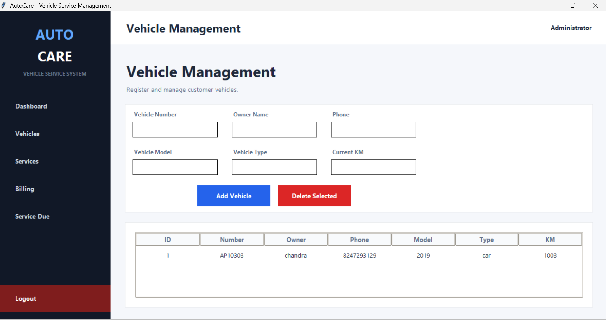

# 🚗 AutoCare Vehicle Management System

## 📌 Project Description

AutoCare Vehicle Management System is a desktop application developed using **Python, Tkinter, and SQLite**. It helps users manage vehicle records, track service schedules, and maintain vehicle information efficiently through a user-friendly graphical interface.

## 🖥️ Application Screenshot



## ✨ Features

* Add Vehicle Records
* Search Vehicle Details
* Update Vehicle Information
* Delete Vehicle Records
* Service Due Date Checker
* SQLite Database Storage
* User-Friendly Tkinter GUI

## 🛠️ Technologies Used

* **Python** – Application development
* **Tkinter** – Graphical User Interface
* **SQLite** – Database management

## 📂 Project Structure

```text
AutoCare-Vehicle-Management-System/
│
├── main.py
├── database.py
├── autocare.db
├── README.md
│
└── screenshots/
    └── main_window.png
```

## ⚙️ Installation and Execution

### 1. Clone the Repository

```bash
git clone https://github.com/cs7943396-design/AutoCare-Vehicle-Management-System.git
```

### 2. Open the Project Folder

```bash
cd AutoCare-Vehicle-Management-System
```

### 3. Run the Application

```bash
python main.py
```

## 📦 Modules

### 1. Vehicle Management

* Add Vehicle
* Search Vehicle
* Update Vehicle
* Delete Vehicle

### 2. Service Management

* Track Service Dates
* Service Due Notifications

## 🚀 Future Enhancements

* PDF Report Generation
* Email Notifications
* Cloud Database Integration
* Mobile Application Support
* Vehicle Expense Tracking

## 👨‍💻 Author

**Chandra Sekhar Reddy**

## 📄 License

This project is created for educational purposes.
